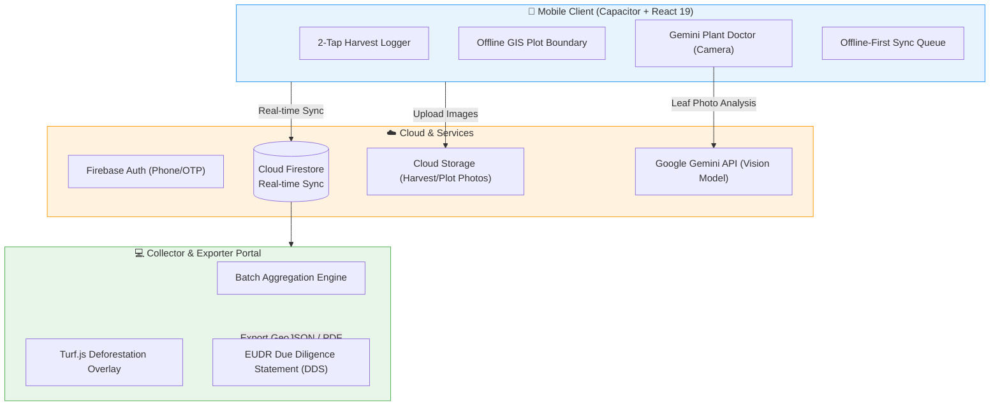
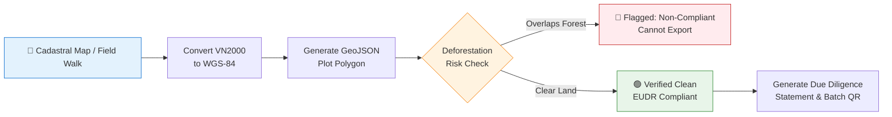
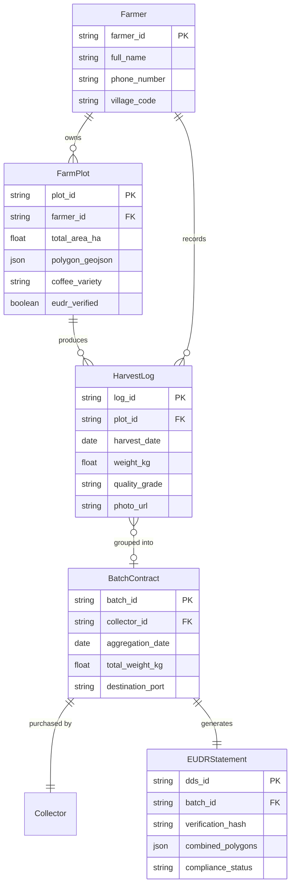

# ☕ BeanLink (CoffeeLink Agri-OS) — EUDR Coffee Traceability Platform

> A mobile-first agritech platform that helps coffee smallholders in Vietnam digitize daily harvest logging, convert cadastral parcel boundaries to international WGS-84 polygons, and guarantee full compliance with the European Union Deforestation Regulation (EUDR).

<div align="center">

[](#)
[](#)
[](#)
[](#)
[](#)
[](#)

</div>

---

## 📑 Business Analyst & Systems Architecture Deliverables

This repository is maintained as a **Case Study in Systems Analysis & Requirements Engineering**. The complete technical specification suite is organized under [`docs/`](docs/):

| Deliverable Domain | Documentation & Artifacts | Primary Focus |
|:---|:---|:---|
| **Business Requirements** | [`docs/requirements/BRD_EUDR_Traceability.md`](docs/requirements/BRD_EUDR_Traceability.md)<br>[`docs/requirements/User_Stories_Acceptance_Criteria.md`](docs/requirements/User_Stories_Acceptance_Criteria.md) | Problem Statement, Scope, Business Rules (BR01–BR10), Agile User Stories with Gherkin Acceptance Criteria |
| **Process Modeling (BPMN)** | [`docs/process-modeling/BPMN_As_Is_vs_To_Be.md`](docs/process-modeling/BPMN_As_Is_vs_To_Be.md)<br>[`docs/process-modeling/EUDR_Compliance_Pipeline.md`](docs/process-modeling/EUDR_Compliance_Pipeline.md) | As-Is vs To-Be Workflows, Cycle Time Scorecard, VN2000 to WGS-84 Cadastral Transformation, Turf.js Validation |
| **Data Architecture** | [`docs/architecture/Data_Model_ERD.md`](docs/architecture/Data_Model_ERD.md) | 3NF Relational Database Schema, Spatial Geometry Indexing, Data Dictionary & Integrity Constraints |
| **API & Systems Integration** | [`docs/api/API_Specification.md`](docs/api/API_Specification.md)<br>[`docs/api/BeanLink_Postman_Collection.json`](docs/api/BeanLink_Postman_Collection.json) | RESTful API Contract, Warehouse Stock Sync, Importable Postman Collection with Request/Response Payloads |
| **UI/UX & Field Usability** | [`docs/ui-ux/Design_System_Wireframes.md`](docs/ui-ux/Design_System_Wireframes.md)<br>[`docs/ui-ux/DESIGN_SYSTEM.md`](docs/ui-ux/DESIGN_SYSTEM.md) | 20+ Farmer Usability Study in Lam Dong, 2-Tap Harvest Heuristics, Cyber-Agritech High-Contrast Theme |

---

## What This Project Is

This is a **self-initiated R&D project** developed with one teammate during Sep–Dec 2025. I was the **Business Analyst & UX Researcher** — responsible for interviewing farmers in the Central Highlands, mapping workflows, analyzing EU export compliance requirements (EUDR), and designing the mobile user experience.

**The Problem:** Vietnam is the world's 2nd largest coffee producer, but over 85% of coffee comes from smallholders who still record harvests in paper notebooks. When the European Union enacted the EU Deforestation Regulation (EUDR), exporters faced strict requirements: every single export batch must prove it originated from non-deforested land with precise GPS plot polygons. Smallholder farmers had no easy digital tool to provide this.

**Our Solution:** A mobile app built for field conditions where farmers can log harvests in 2 taps, view plot boundaries on an interactive map, and generate EUDR-compliant geolocation data for collectors and exporters.

---

## System Architecture



---

## Key BA & Research Contributions

### 1. As-Is vs. To-Be Process Mapping (BPMN)

I conducted on-site field research with **20+ coffee farmers in Lam Dong Province** to understand their workflow. The contrast between the legacy paper method and BeanLink:

```mermaid
flowchart TD
    subgraph Legacy["❌ As-Is: Traditional Paper Workflow"]
        A1[Farmer picks coffee cherries] --> B1[Records weight in paper notebook]
        B1 --> C1[Collector arrives; notes copied onto paper slips]
        C1 --> D1[High error rate / lost slips / no GPS data]
        D1 --> E1[Exporter cannot verify plot origin for EUDR compliance]
    end

    subgraph Modern["✅ To-Be: BeanLink Digital Flow"]
        A2[Farmer picks coffee cherries] --> B2[2-Tap Log in BeanLink App\nWeight + Auto-Timestamp]
        B2 --> C2[Real-time sync to Collector Portal with GPS Polygon]
        C2 --> D2[Turf.js validates plot against Forest Boundary Data]
        D2 --> E2[EUDR Due Diligence Statement & QR Code generated]
    end

    style Legacy fill:#ffebee,stroke:#C62828
    style Modern fill:#e8f5e9,stroke:#388E3C
```



*Key Insight from Field Interviews:* Most farmers are aged 45–65, work in direct sunlight, and wear thick farming gloves. This led directly to our 2-tap UI design with high-contrast buttons and optional voice input.

---

### 2. EUDR Geolocation & Compliance Pipeline

Under EUDR Article 9, coffee plots >= 4 hectares require full polygon coordinates (not just a single center point). I researched the technical specifications and defined the compliance transformation flow:



- **Coordinate Transformation:** Vietnamese land records use **VN2000 (local projection)**, whereas the EU portal requires **WGS-84 (lat/long standard)**. I specified the transformation requirements implemented with Turf.js.
- **Deforestation Overlay:** Automated geospatial intersection check between farm polygons and European Commission baseline forest maps (Cutoff date: Dec 31, 2020).

---

### 3. Data Model (ERD)



---

### 4. Field Testing Results

We tested the prototype directly on 20+ farms in Bao Loc and Di Linh, Lam Dong:

| Metric | Before (Paper Log) | With BeanLink | Improvement |
| :--- | :--- | :--- | :--- |
| **Harvest Logging Time** | ~15 minutes / day | **< 15 seconds** | **98% faster** |
| **First-Time Completion Rate** | N/A | **85%** without training | High usability |
| **Data Loss / Transcription Error** | ~12% paper loss | **0%** (auto-synced) | 100% reliable |
| **EUDR Geolocation Export** | Manual (weeks) | **Instant** GeoJSON export | Production-ready |

---

## Tech Stack

| Layer | Technologies | Role |
| :--- | :--- | :--- |
| **Frontend UI** | React 19, TypeScript, Vite, Tailwind CSS | High-contrast, mobile-first responsive interface |
| **Mobile Runtime** | Capacitor 8 | Bridges web app to native Android APK |
| **GIS & Mapping** | Leaflet, React-Leaflet, Turf.js | Plot polygon rendering, area calculation, coordinate projection |
| **AI Assistant** | Google Gemini Vision API | Fast leaf photo diagnostic for coffee rust & pests |
| **Cloud Backend** | Firebase Firestore & Cloud Storage | Offline-first sync and photo documentation |

---

## Running Locally

```bash
# Clone the repository
git clone https://github.com/toilanguyenzz/Coffe-Link-Beta.git
cd Coffe-Link-Beta

# Install dependencies
npm install

# Run Vite development server
npm run dev

# Or build native Android APK via Capacitor
npm run build
npx cap sync
npx cap open android
```

---

<div align="center">
Developed by <strong>Ta Nguyen Khoi Nguyen & Teammate</strong> · Applied Agritech R&D (Sep–Dec 2025)
</div>
