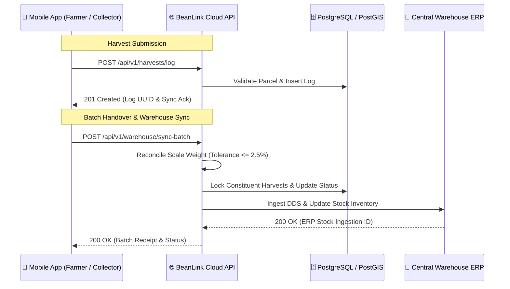

# 🔌 RESTful API Contract & Postman Verification
## Technical Specification: Warehouse Stock Synchronization & Harvest Ingestion

**Author:** Ta Nguyen Khoi Nguyen (Business Analyst & System Analyst)  
**Standard:** OpenAPI 3.0 / RESTful JSON Architecture  
**Verification Tool:** Postman v10+ (Collection enclosed: `BeanLink_Postman_Collection.json`)  

---

## 1. Overview & Architectural Boundaries
The BeanLink REST API acts as the bridge connecting mobile field clients (Capacitor/React), local collector aggregation stations, and the centralized ERP warehouse system.



---

## 2. API Endpoints

### 1. `POST /api/v1/harvests/log`
Records an atomic harvest transaction from the mobile client.

* **Request Headers:**
  * `Content-Type: application/json`
  * `Authorization: Bearer <jwt_farmer_token>`
  * `X-Client-Timestamp: 2025-11-14T09:30:00Z`

* **Request Payload:**
```json
{
  "parcel_id": "7b8e1a4d-9c3f-42e1-87ab-18e0d49f6b92",
  "net_weight_kg": 85.50,
  "coffee_variety": "Robusta",
  "moisture_percentage": 14.2,
  "telemetry": {
    "gps_latitude": 11.575283,
    "gps_longitude": 107.808912,
    "accuracy_radius_meters": 4.5,
    "altitude_meters": 850.2
  },
  "device_offline_signature": "e3b0c44298fc1c149afbf4c8996fb92427ae41e4649b934ca495991b7852b855"
}
```

* **Response `201 Created`:**
```json
{
  "status": "SUCCESS",
  "data": {
    "harvest_id": "c1f83e29-6a5b-4c2d-98e1-58291f0a4b3d",
    "parcel_id": "7b8e1a4d-9c3f-42e1-87ab-18e0d49f6b92",
    "verified_weight_kg": 85.50,
    "sync_status": "SYNCED",
    "eudr_precheck": "PASSED_GREEN",
    "created_at": "2025-11-14T09:30:02.185Z"
  }
}
```

---

### 2. `POST /api/v1/warehouse/sync-batch`
Synchronizes an aggregated collector batch with the central warehouse ERP.

* **Request Payload:**
```json
{
  "batch_code": "BATCH-2025-LD-0842",
  "collector_id": "col_vn_ld_004",
  "warehouse_id": "wh_bao_loc_central",
  "physical_scale_weight_kg": 1182.50,
  "constituent_harvest_ids": [
    "c1f83e29-6a5b-4c2d-98e1-58291f0a4b3d",
    "f2a94d18-7b6c-4d3e-89f2-69302f1b5c4e"
  ],
  "qr_verification_hash": "a1b2c3d4e5f67890123456789abcdef0123456789abcdef0123456789abcdef0"
}
```

* **Response `200 OK` (Reconciliation Passed):**
```json
{
  "status": "RECONCILED_AND_COMMITTED",
  "data": {
    "batch_code": "BATCH-2025-LD-0842",
    "system_cumulative_weight_kg": 1200.00,
    "physical_scale_weight_kg": 1182.50,
    "variance_percentage": -1.46,
    "tolerance_status": "WITHIN_ACCEPTABLE_LIMIT_2.5_PCT",
    "erp_stock_ingestion_id": "ERP-GRN-2025-99210",
    "eudr_due_diligence_reference": "DDS-EU-2025-VN-COFFEE-004821",
    "timestamp": "2025-11-14T14:15:30Z"
  }
}
```

* **Response `422 Unprocessable Entity` (Tolerance Exceeded):**
```json
{
  "status": "RECONCILIATION_FAILED",
  "error": {
    "code": "ERR_WEIGHT_TOLERANCE_EXCEEDED",
    "message": "Physical scale weight deviation (-4.8%) exceeds maximum allowed threshold of ±2.5%.",
    "details": {
      "system_cumulative_weight_kg": 1200.00,
      "physical_scale_weight_kg": 1142.40,
      "variance_percentage": -4.80
    }
  }
}
```

---

## 3. Postman Collection Verification
The companion file **`BeanLink_Postman_Collection.json`** includes pre-configured environment variables, request bodies, mock response tests, and JavaScript test scripts validating schema contracts and status codes.
