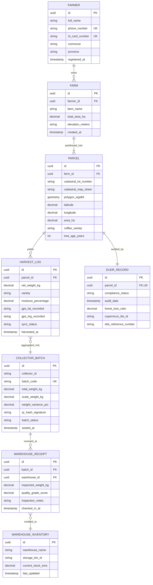

# 🗄️ Relational Data Model & ERD Specification
## 3NF Database Architecture for Traceability & Supply Chain Ingestion

**Author:** Ta Nguyen Khoi Nguyen (Business Analyst & System Analyst)  
**Standard:** Third Normal Form (3NF), ISO 19125-1 (Simple Features for SQL / GIS)  

---

## 1. Entity-Relationship Diagram (ERD)

---

## 2. Data Dictionary & Integrity Rules

### Table: `PARCEL`
| Column Name | Data Type | Nullable | Constraints | Business Description |
|:---|:---|:---:|:---|:---|
| `id` | UUID | NO | Primary Key | Global unique identifier for the parcel |
| `farm_id` | UUID | NO | Foreign Key -> `FARM(id)` | Parent farm identity |
| `cadastral_lot_number` | VARCHAR(50) | NO | NOT NULL | Official land plot number ("Số thửa") from Land Certificate |
| `cadastral_map_sheet` | VARCHAR(50) | NO | NOT NULL | Official map sheet number ("Số tờ bản đồ") |
| `polygon_wgs84` | GEOMETRY(Polygon, 4326) | YES | Spatial Index (GIST) | EPSG:4326 boundary polygon formatted as GeoJSON |
| `latitude` | DECIMAL(10, 7) | NO | -90.0 to +90.0 | Parcel centroid latitude (6 decimal places for 0.1m precision) |
| `longitude` | DECIMAL(10, 7) | NO | -180.0 to +180.0 | Parcel centroid longitude |
| `area_ha` | DECIMAL(8, 2) | NO | CHECK (`area_ha` > 0.0) | Calculated land surface in hectares |
| `coffee_variety` | VARCHAR(30) | NO | ENUM('Robusta', 'Arabica', 'Catimor') | Coffee cultivar planted |

### Table: `HARVEST_LOG`
| Column Name | Data Type | Nullable | Constraints | Business Description |
|:---|:---|:---:|:---|:---|
| `id` | UUID | NO | Primary Key | Transaction identifier |
| `parcel_id` | UUID | NO | Foreign Key -> `PARCEL(id)` | Must reference a registered, approved parcel |
| `net_weight_kg` | DECIMAL(8, 2) | NO | CHECK (`net_weight_kg` > 0.0) | Harvest weight in kilograms |
| `gps_lat_recorded` | VARCHAR(25) | NO | NOT NULL | Device GPS latitude captured at the moment of logging |
| `gps_lng_recorded` | VARCHAR(25) | NO | NOT NULL | Device GPS longitude captured at the moment of logging |
| `sync_status` | VARCHAR(20) | NO | ENUM('SYNC_PENDING', 'SYNCED', 'REJECTED') | Offline queue replication state |
| `harvested_at` | TIMESTAMP | NO | <= CURRENT_TIMESTAMP | Exact date and time when cherries were harvested |

---

## 3. Normalization Audit (1NF -> 2NF -> 3NF)
1. **First Normal Form (1NF):** All attributes contain atomic values (polygons are stored via standard GIS spatial primitives; multiple coordinates are structured inside OGC compliant geometry columns).
2. **Second Normal Form (2NF):** No partial dependencies on composite keys. All non-key attributes (`area_ha`, `coffee_variety`) are fully functionally dependent on the primary key `id`.
3. **Third Normal Form (3NF):** No transitive dependencies exist. Farm ownership information (`farmer_id`) is strictly bound to `FARM`, avoiding duplicate farmer attributes inside `PARCEL` or `HARVEST_LOG`.
