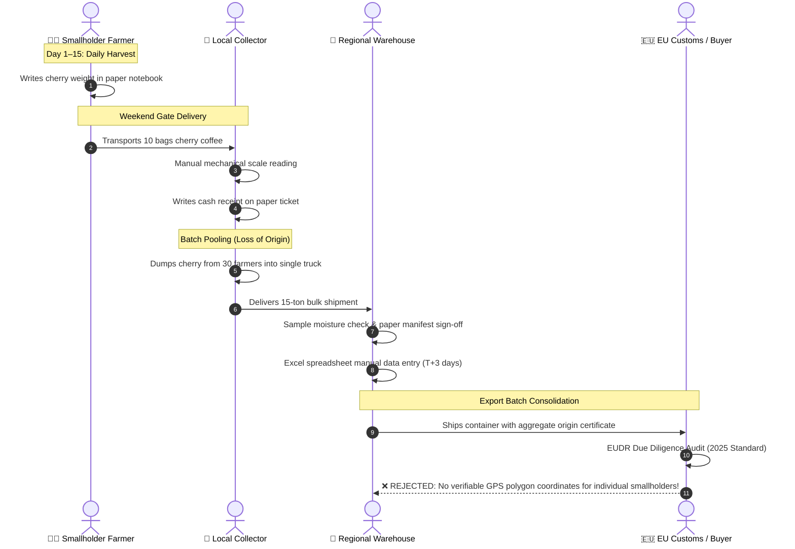

# 🔄 Business Process Model and Notation (BPMN 2.0)
## As-Is vs. To-Be Supply Chain Workflows & EUDR Traceability

**Author:** Ta Nguyen Khoi Nguyen (Business Analyst & System Analyst)  
**Methodology:** BPMN 2.0 Process Modeling, Gap Analysis, Lean Value Stream Mapping  

---

## 1. As-Is Process: Paper-Based Harvest & Fragile Intermediary Chain

In the legacy supply chain across the Central Highlands (Lam Dong, Dak Lak), harvest tracking is entirely manual, fragmented, and vulnerable to data loss:



### Critical As-Is Failure Modes
1. **Origin Amnesia:** Once the collector pools cherry sacks into the transport truck, origin traceability is permanently severed.
2. **Data Latency:** Data reaches the central ERP warehouse system 3 to 7 days after harvest.
3. **Audit Incompatibility:** Paper tickets cannot prove that coffee was harvested outside national conservation parks.

---

## 2. To-Be Process: BeanLink Digital Traceability & Verified Custody

BeanLink transforms this disconnected pipeline into an immutable, digital chain of custody from farm parcel to container vessel:

```mermaid
sequenceDiagram
    autonumber
    actor F as 🧑‍🌾 Smallholder Farmer
    participant APP as 📱 BeanLink Mobile (Offline-First)
    actor C as 🚚 Collector
    participant CLOUD as ☁️ Cloud & EUDR Engine
    actor W as 🏬 Central Warehouse

    Note over F,APP: At the Farm Plot
    F->>APP: 2-Tap Harvest Entry (e.g. 80kg Robusta)
    APP->>APP: Auto-stamps GPS Lat/Long & Parcel Polygon ID
    APP->>APP: Queues encrypted transaction in IndexedDB
    Note over F,C: Farm Gate Handover
    F->>C: Delivers bags; displays Batch QR on phone
    C->>APP: Scans Farmer QR with Collector App
    APP->>APP: Reconciles weight with Bluetooth scale (Tolerance <= 2.5%)
    C->>APP: Signs digital custody transfer
    Note over APP,CLOUD: Background Connectivity Sync
    APP->>CLOUD: Flushes queued sync packets via Web Worker
    CLOUD->>CLOUD: Turf.js Polygon Validation & Dec 31 2020 Forest Check
    CLOUD->>W: Real-time inventory pre-alert & verified DDS package
    Note over W: Warehouse Ingestion
    C->>W: Truck arrives at warehouse gate
    W->>CLOUD: 1-Scan QR check-in & automated ERP reconciliation (Postman API)
    W-->>F: Instant SMS / In-App confirmation & direct bank transfer
```

---

## 3. Process Improvement Scorecard

| Process Dimension | As-Is (Legacy Supply Chain) | To-Be (BeanLink Agri-OS) | Improvement Impact |
|:---|:---|:---|:---|
| **Harvest Logging Duration** | 8.5 min/entry (searching notebook, manual arithmetic) | **12 seconds** (2-tap stepper or voice dictation) | **97.6% reduction in logging time** |
| **Traceability Granularity** | Regional cooperative level (~5,000 ha blob) | **Cadastral parcel level** (exact GeoJSON polygon) | **100% compliant with EUDR Art. 9** |
| **Data Ingestion Latency** | 3 – 7 days (manual paper collection & re-typing) | **Near real-time** (< 5 seconds once online) | **99.9% latency reduction** |
| **Inventory Shrinkage** | 14.2% unaccounted discrepancy across middleman chain | **< 0.8% deviation** (strict BR05 scale tolerance) | **13.4% financial loss recovered** |
| **Audit Preparation Cost** | $120–$180 per export container (manual consulting) | **$0 / automated** (1-click Due Diligence Statement) | **100% automation of DDS generation** |
