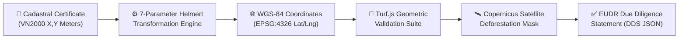

# 🌍 EUDR Compliance & Cadastral GIS Pipeline
## Technical Specification: Cadastral Polygon Conversion & Deforestation Verification

**Author:** Ta Nguyen Khoi Nguyen (Business Analyst & System Analyst)  
**Standard Reference:** Regulation (EU) 2023/1115 (EUDR), Vietnamese Cadastral Standard TCVN 9401:2012 (VN2000)  

---

## 1. Regulatory Context (EUDR Articles 9 & 10)
Under EUDR Article 9, operators must collect the **geolocation of all plots of land** where the relevant commodities were produced, alongside the date or time range of production:
* For plots **< 4 hectares:** A single point coordinate (Latitude and Longitude, minimum 6 decimal places).
* For plots **>= 4 hectares:** A closed polygon with sufficient latitude and longitude points to describe the perimeter.

In Vietnam, official land ownership ("Sổ Đỏ" / Land Use Certificates) uses the **VN2000** coordinate reference system (Transverse Mercator projection based on the WGS-84 ellipsoid with customized local central meridians: 107°45' for Lam Dong, 108°30' for Dak Lak). These local meters-based coordinates **cannot be consumed directly by EU customs systems**, which mandate international **WGS-84 (EPSG:4326)** decimal degrees.

---

## 2. Cadastral Conversion Pipeline (VN2000 -> WGS-84)



### Transformation Mathematics
Conversion from local VN2000 projected coordinates $(X, Y)$ to geodetic WGS-84 $(\phi, \lambda)$ involves:
1. Inverse Transverse Mercator projection using the provincial Central Meridian ($L_0$):
   $$\phi, \lambda = \text{InvTM}(X, Y, L_0, k_0 = 0.9999)$$
2. 7-Parameter Bursa-Wolf/Helmert spatial datum shift:
   $$\begin{bmatrix} X_{WGS} \\ Y_{WGS} \\ Z_{WGS} \end{bmatrix} = \begin{bmatrix} \Delta X \\ \Delta Y \\ \Delta Z \end{bmatrix} + (1 + m) \begin{bmatrix} 1 & -\omega_z & \omega_y \\ \omega_z & 1 & -\omega_x \\ -\omega_y & \omega_x & 1 \end{bmatrix} \begin{bmatrix} X_{VN} \\ Y_{VN} \\ Z_{VN} \end{bmatrix}$$
   *Parameters for Lam Dong Province:* $\Delta X = -191.904$, $\Delta Y = -39.303$, $\Delta Z = -111.450$, $m = -0.009288 \times 10^{-6}$.

---

## 3. Client-Side Polygon Validation (Turf.js)

To prevent invalid geometries from corrupting cloud records, the client runs 4 pre-flight geometric validations using `@turf/turf`:

```typescript
import * as turf from '@turf/turf';

interface PolygonValidationResult {
  isValid: boolean;
  areaHectares: number;
  centroid: [number, number];
  errorMessage?: string;
}

export function validateFarmPolygon(coordinates: [number, number][]): PolygonValidationResult {
  // Rule 1: Ensure minimum 4 vertices (3 corners + 1 closure point)
  if (coordinates.length < 4) {
    return { isValid: false, areaHectares: 0, centroid: [0, 0], errorMessage: "Polygon must contain at least 3 vertices." };
  }

  // Rule 2: Ensure polygon is closed (First point equals last point)
  const first = coordinates[0];
  const last = coordinates[coordinates.length - 1];
  if (first[0] !== last[0] || first[1] !== last[1]) {
    coordinates.push([first[0], first[1]]); // Auto-close boundary
  }

  const polygon = turf.polygon([coordinates]);

  // Rule 3: Check for self-intersections (Kinks)
  const kinks = turf.kinks(polygon);
  if (kinks.features.length > 0) {
    return { isValid: false, areaHectares: 0, centroid: [0, 0], errorMessage: "Polygon boundary intersects with itself." };
  }

  // Rule 4: Compute area in Hectares
  const areaSqMeters = turf.area(polygon);
  const areaHectares = Number((areaSqMeters / 10000).toFixed(2));

  // Compute centroid for map centering
  const centroidFeature = turf.centroid(polygon);
  const centroid = centroidFeature.geometry.coordinates as [number, number];

  return { isValid: true, areaHectares, centroid };
}
```

---

## 4. Deforestation Screening Workflow (Dec 31, 2020 Baseline)

1. **Polygon Bounding Box Query:** The client or server extracts the bounding box of the validated parcel polygon:
   $$[\min(\lambda), \min(\phi), \max(\lambda), \max(\phi)]$$
2. **Satellite Raster Sampling:** Intersects the polygon against the Copernicus Global Land Service 10m Tree Cover Density (TCD) layer for baseline year 2020 vs current year.
3. **Encroachment Verdict:**
   * If `Forest_Loss_Post_2020 == 0%` $\rightarrow$ `Status: EUDR_COMPLIANT_APPROVED`
   * If `Forest_Loss_Post_2020 > 0%` $\rightarrow$ `Status: EUDR_NON_COMPLIANT_REJECTED` (Triggers alert and blocks batch generation).
