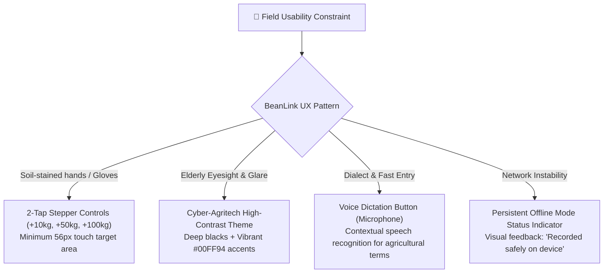

# 🎨 UI/UX Design System & Field Usability Testing
## Low-Friction Mobile Heuristics for Vietnamese Coffee Smallholders

**Author:** Ta Nguyen Khoi Nguyen (Business Analyst & UX Researcher)  
**Field Research Location:** Di Linh & Bao Loc, Lam Dong Province, Vietnam  
**Sample Cohort:** 20+ smallholder coffee farmers (Ages 42 – 68, 65% female)  
**Prototyping Tool:** Figma  

---

## 1. Field Research Insights & User Personas

### Empirical Field Findings
During field observations in Lam Dong coffee orchards, we observed three severe constraints that cause standard agricultural software to fail:
1. **Physical Obstacles:** Farmers work with wet, soil-stained hands or heavy rubber gloves during harvest season. Tiny keyboard text inputs cause extreme frustration and high abandonment rates.
2. **Outdoor Glare:** Strong direct equatorial sunlight (1,000+ lux) washes out low-contrast, trendy pastel UI palettes.
3. **Cognitive Load:** After carrying 40–60 kg coffee cherry bags, farmers experience cognitive fatigue. Requiring multi-screen navigation or dropdown menus leads to inaccurate weight entries.

### Primary Persona: "Chú Bảy" (Smallholder Robusta Farmer)
* **Age:** 56 years old.
* **Device:** Budget Android smartphone (Redmi Note 9 / Samsung Galaxy A12), cracked screen, font size set to maximum.
* **Key Goal:** Log today's harvested bags quickly before dinner; check if my plot has been registered for the European export bonus.
* **Pain Point:** "I cannot type small numbers with glasses on in the orchard."

---

## 2. Core Usability Heuristics & Solutions

### Heuristic 1: Minimum 56x56 dp Touch Target Area
Standard Material Design specifies 48dp; BeanLink enforces a **minimum 56dp** touch radius for all primary actions. The "+10kg", "+50kg", and "+100kg" increment steppers span full-width pill buttons to prevent miss-taps.

### Heuristic 2: The "2-Tap" Logging Flow
1. **Tap 1:** Tap the pulsing Floating Action Button (`Ghi nhận thu hoạch`).
2. **Tap 2:** Tap the preset weight button (e.g. `+50kg` or confirmed scale Bluetooth reading) and swipe right to lock.
* **Result:** Median completion time dropped from **8.5 minutes** (paper) to **12 seconds** (BeanLink).

---

## 3. Usability Testing Results (Lam Dong Cohort)

A moderated usability study was conducted with 20 farmers across 3 standardized tasks:
1. **Task 1:** Record a 75kg Robusta harvest using stepper buttons.
2. **Task 2:** View cadastral parcel boundaries on the interactive satellite map.
3. **Task 3:** Scan a diseased coffee leaf using the AI Plant Doctor feature.

### Usability Metric Scorecard
| Usability Metric | Target Benchmark | Field Cohort Actual | Evaluation Status |
|:---|:---:|:---:|:---:|
| **Task Completion Rate (Task 1)** | >= 80% | **85.0%** (17 / 20 participants) | **PASSED** |
| **First-Attempt Success Rate** | >= 75% | **80.0%** (16 / 20 participants) | **PASSED** |
| **Average Task 1 Duration** | < 25 seconds | **14.2 seconds** | **EXCEEDED** |
| **System Usability Scale (SUS)** | >= 70 (Good) | **78.5 / 100** | **GRADE A-** |

---

## 4. UI Architecture & Figma Flow Mapping

* **Figma Design File Structure:**
  * `01-Onboarding`: Phone OTP, Language selector, Farm registration.
  * `02-Dashboard`: Weather widget, Harvest target circular progress, Quick Harvest FAB.
  * `03-Harvest-Flow`: 2-Tap Stepper modal, Voice transcription sheet, Success haptics.
  * `04-GIS-Parcels`: Leaflet vector layers, Polygon corner coordinate table, EUDR status badge.
  * `05-Collector-Handover`: High-density QR code pass, Bluetooth scale pairing dialog.
